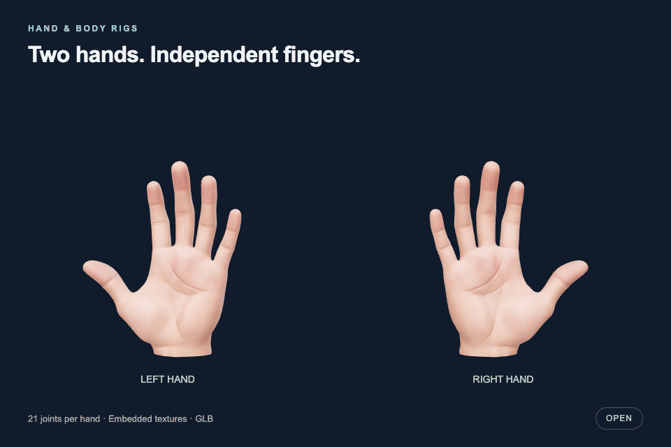
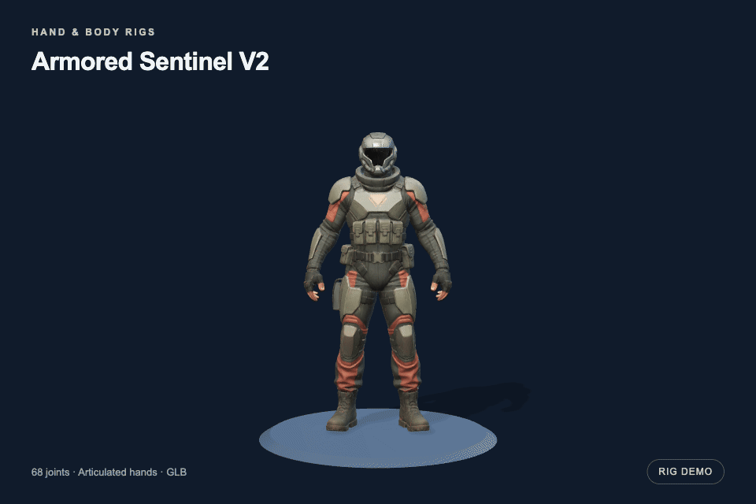
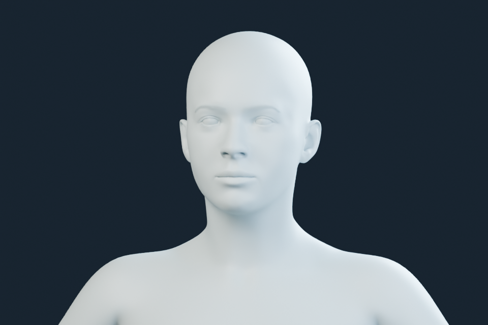
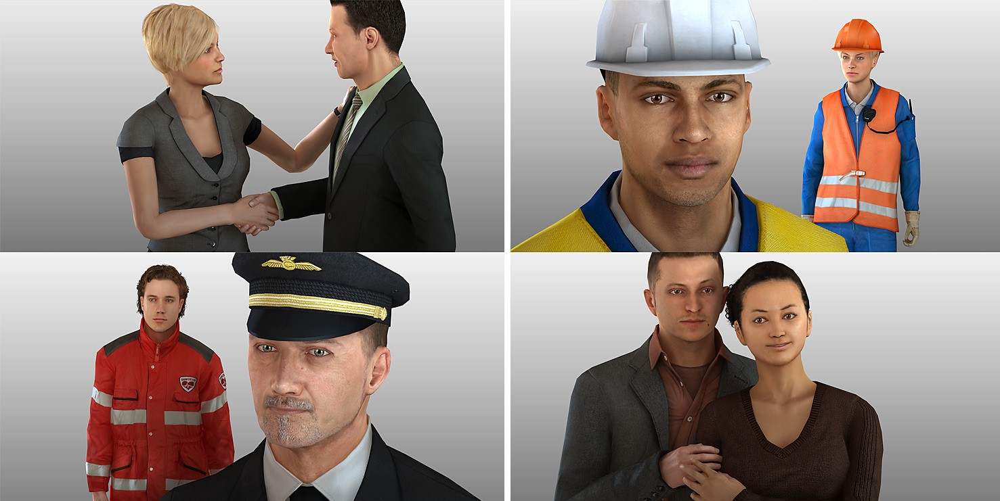

# Hand & Body Rigs

Copyright © 2026 Forrest Moulin.

A growing collection of reusable 3D hand and full-body rigs, with simple joint
mappings for developers, artists and agents. Models are self-contained GLBs with
embedded textures, ready to import into a GLB-compatible application.

**[Download the full collection](https://github.com/heyfoz/hand-and-body-rigs/releases/latest/download/hand-and-body-rigs.zip)**
· [Hands only](https://github.com/heyfoz/hand-and-body-rigs/releases/latest/download/hand-rigs.zip)
· [Sentinel only](https://github.com/heyfoz/hand-and-body-rigs/releases/latest/download/sentinel-rig.zip)

## Available rigs

| Rig | Model | Mapping and instructions |
| --- | --- | --- |
| Left hand | [left-hand.glb](hands/assets/left-hand.glb) | [Hand guide](hands/README.md) · [Mappings](hands/mappings.json) |
| Right hand | [right-hand.glb](hands/assets/right-hand.glb) | [Hand guide](hands/README.md) · [Mappings](hands/mappings.json) |
| Armored Sentinel V2 | [sentinel.glb](bodies/sentinel/assets/sentinel.glb) | [Sentinel guide](bodies/sentinel/README.md) · [Mappings](bodies/sentinel/mappings.json) |

## Rig previews

### Hands



[Still image](hands/previews/preview.png) · [MP4 video](hands/previews/motion.mp4)

### Armored Sentinel V2



[Still image](bodies/sentinel/previews/preview.png) · [MP4 video](bodies/sentinel/previews/motion.mp4)

These loops are rendered from the included GLBs. They demonstrate joint movement;
the downloadable models remain static rigs without embedded animation clips.
The demo poses are illustrative, not ASL instruction.

## Quick start

1. Download a package or an individual GLB from the table above.
2. Load the GLB and find its joints by name using the matching mapping file.
3. Preserve the rest transforms and bone lengths when posing or retargeting.

The mappings identify joints; your application supplies animation or tracking.
Each standalone hand has 21 joints. Sentinel has 68 skin joints, including
articulated fingers, and no animation clips or facial morph targets.

## Folder layout

```text
hands/                  Standalone hand models, guide and mappings
bodies/
  sentinel/             Sentinel model, preview, guide, mappings and license
```

To add another body rig, create `bodies/<rig-name>/` with its GLB, a short README,
joint mappings, license and optional preview. Use `hands/<rig-name>/` for another
hand set. Add the new rig to the table above. Keep each model's source and license
clear in its own folder.

## Other open character sources

- **[Vitruvian for CharMorph](https://github.com/Upliner/CharMorph-Vitruvian)**:
  a customizable human model with facial expressions and multiple rig options.
  [CC0 asset license](https://github.com/Upliner/CharMorph-Vitruvian/blob/main/config.yaml).
  Follow the upstream README for CharMorph/Blender installation.
- **[Microsoft Rocketbox](https://github.com/microsoft/Microsoft-Rocketbox)**:
  a collection of rigged human characters.
  [MIT license](https://github.com/microsoft/Microsoft-Rocketbox/blob/master/LICENSE.md);
  keep Microsoft's copyright and license with redistributed assets.

| Vitruvian | Microsoft Rocketbox |
| --- | --- |
| [](https://github.com/Upliner/CharMorph-Vitruvian) | [](https://github.com/microsoft/Microsoft-Rocketbox) |
| A clay render of the CC0 base mesh, without textures or hair. | Official collection preview, © Microsoft, MIT licensed. |

These links point to the original projects; their model files are not bundled.
See [preview sources and credits](media/README.md).

## License

Sentinel and its documentation/mappings are released under the
[MIT License](bodies/sentinel/LICENSE.txt): use, modify and share, including
commercially, while retaining the copyright and license notice.

The standalone hands retain their [existing rights notice](hands/README.txt).
Their source-model license was not recorded; the MIT notice covers the hand
documentation/mappings and Forrest Moulin's original contributions.

See each rig's license before using it; new additions may have different terms.
