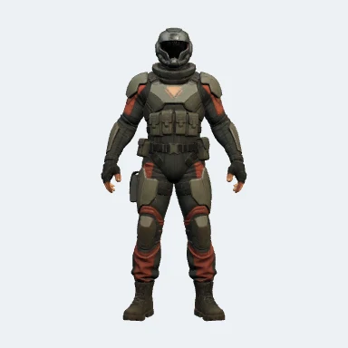

# Armored Sentinel V2

Copyright © 2026 Forrest Moulin. Released under the [MIT License](LICENSE.txt).

A full-body rigged character with embedded textures, 68 skin joints and
articulated hands. Includes 30 finger controls and 10 fingertip endpoints.
This is a static rig: animation clips and facial expression controls are not included.

| File | Purpose |
| --- | --- |
| `assets/sentinel.glb` | Self-contained character, ready to import |
| `mappings.json` | Body chains and all hand landmark-to-bone mappings |
| `preview.webp` | Character preview |
| `LICENSE.txt` | Permission to use, modify and redistribute |

## Using the rig

1. Import `assets/sentinel.glb` in your GLB-compatible application.
2. Find joints by the exact names in `mappings.json`, not their node indices.
3. Keep the rest pose and bone lengths. Animate local joint rotations and the
   root transform; convert tracking coordinates before computing rotations.

Body chains run from parent to child. `LeftArm`/`RightArm` mean upper arm;
`LeftForeArm`/`RightForeArm` mean lower arm. `UpLeg` means thigh and `Leg` means shin.

Each hand starts at `LeftHand` or `RightHand`. Add `Thumb`, `Index`, `Middle`,
`Ring` or `Pinky`, then `1`, `2`, `3` or `4`. Joints 1–3 control the finger;
joint 4 is its tip endpoint. Example: `LeftHandIndex2` maps to MediaPipe hand
landmark 6. The hand indices follow the [MediaPipe reference](https://developers.google.com/edge/mediapipe/solutions/vision/hand_landmarker).

The fingers have a curved rest pose. Calibrate retargeting to this model;
these mappings alone are not a tracking solver or a verified ASL performance.

## Source

Generated by Forrest Moulin using a paid Meshy account, then adapted for
articulated hand control. The included GLB preserves the prepared model's
geometry, textures and rig. [Meshy ownership terms](https://www.meshy.ai/terms-of-use).
