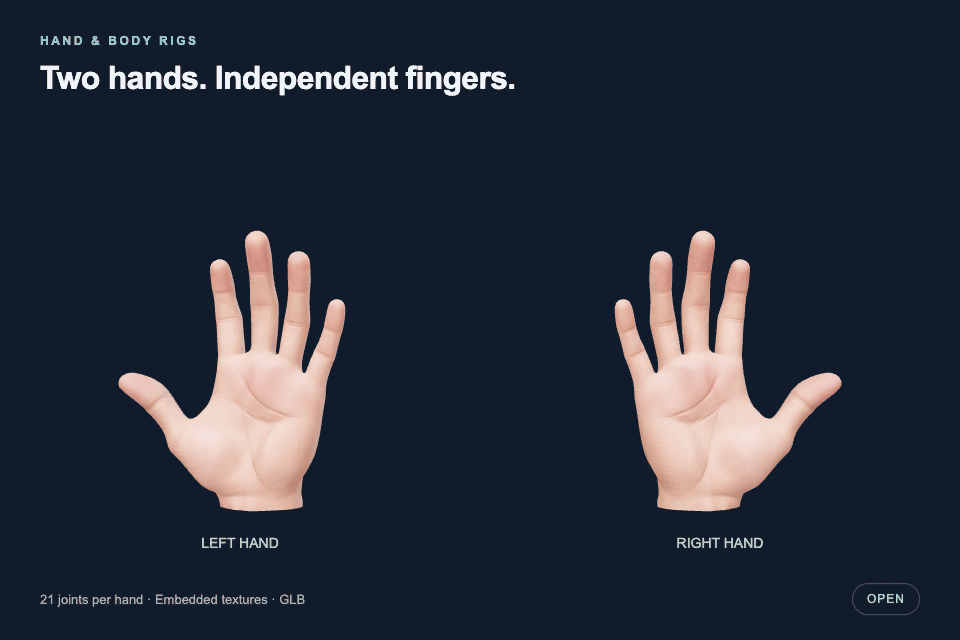

# Hand rigs

Copyright © 2026 Forrest Moulin.

[Still image](previews/preview.png) · [MP4 video](previews/motion.mp4)

Two standalone hand GLBs with embedded textures and 21 joints per hand.
The preview demonstrates the rigs; the GLBs do not contain animation clips.

- [Left hand](assets/left-hand.glb)
- [Right hand](assets/right-hand.glb)
- [Usage and bone mapping guide](README.txt)
- [Machine-readable mappings](mappings.json)
- [License and source-rights notice](LICENSE.txt)
